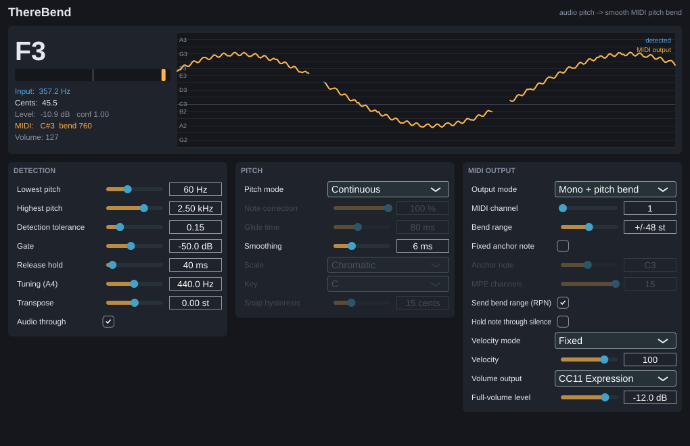

# ThereBend

A VST3 audio-to-MIDI plugin for playing synthesizers with a theremin (or any monophonic
pitched source). Instead of turning pitch into a staircase of MIDI notes, ThereBend holds a
note and drives the synth with **14-bit pitch bend**, so slides and vibrato come out smooth.



## Features

- **Continuous mode**: the detected pitch goes straight to pitch bend, keeping every slide
  and wobble. Optional smoothing.
- **Note glide mode**: pitch snaps to notes (optionally to a scale/key). Each change of note is
  a smooth timed glide, and the held note sits exactly on pitch. "Note correction" below 100 %
  blends some of the player's original expression back in.
- **Two output schemes**:
  - **Mono + pitch bend**: one channel, one held note. When the pitch leaves the bend range,
    a new note starts legato (new note-on before the old note-off), so nothing jumps. With
    ±48 st most theremin performances never retrigger. With **Fixed anchor note** they never do.
  - **MPE**: lower zone, member channels 2–16, one channel per note. Each note keeps its own
    bend, so release tails stay in tune.
- **Volume hand → MIDI**: input level is sent as CC1, CC2, CC7, CC11, CC74 or channel pressure.
  Velocity can be fixed or taken from the onset level.
- **Hold note through silence**: keeps one endless note so only the volume CC articulates.
  Useful when you play the volume antenna like a real theremin.
- Sends the pitch-bend range to the synth via RPN 0 (and the MPE configuration message in MPE mode).
- YIN pitch detector (FFT-accelerated). Detected pitch and MIDI output are shown on a live display.

## Install (Windows)

1. Download `ThereBend-Windows-VST3` from the latest GitHub Actions run (Actions tab → newest
   green run → Artifacts) or from a tagged Release.
2. If you downloaded a zip, right-click it → Properties → tick **Unblock** before extracting.
3. Copy the `ThereBend.vst3` folder to `C:\Program Files\Common Files\VST3\`.
4. In Cubase, open **Studio → VST Plug-in Manager** and rescan if it doesn't appear.

## Cubase setup

1. **Audio track**: put your theremin on an audio track (live input with monitoring, or an
   existing recording) and insert **ThereBend** as an insert effect.
2. **Instrument track**: create one with your synth. Set its **input routing** (Inspector,
   top section) to **ThereBend – MIDI Out**.
3. Enable **Monitor** (or record-arm) on the instrument track to hear the synth live.
   **Preferences → MIDI → MIDI Thru Active** must be on.
4. **Synth settings**:
   - Set the synth's pitch-bend range to match **Bend range** (default ±48). Many synths read
     the RPN that ThereBend sends, but check by ear: a slide of one octave should sound like one.
   - Turn **off** the synth's own portamento/glide (ThereBend does the gliding).
   - Use a mono/legato voice mode if available, so legato retriggers don't restart envelopes.
5. **Record the MIDI**: record-arm the instrument track and record while the theremin plays,
   live or from playback of a recorded audio track. Pitch bend and CCs are recorded with the
   notes, so you can edit them or swap synths later. Make sure **Preferences → MIDI → MIDI Filter**
   isn't filtering Pitchbend or Controllers.
6. **MPE mode**: use an MPE-capable synth (e.g. Vital, Pigments, Equator, Serum 2). In Cubase, enable MPE input for the instrument track in its
   Note Expression/MPE settings if you want the recording converted to Note Expression.

### Latency

Pitch detection needs a couple of periods of the lowest detectable frequency. With
**Lowest pitch** at 60 Hz, the MIDI trails the audio by roughly 30 ms. To reduce it:

- Raise **Lowest pitch** to just below the lowest note you actually play (e.g. 110 Hz ≈ 15–20 ms).
- Lower **Smoothing**.
- For recorded MIDI, set a negative **Track Delay** on the instrument track (e.g. −30 ms) to line it up.

## Parameters

| Group | Parameter | What it does |
|---|---|---|
| Detection | Lowest / Highest pitch | Detection range. Lowest pitch also sets latency (see above). |
| | Detection tolerance | YIN threshold. Raise it if notes drop out; lower it if you get octave jumps or false notes. |
| | Gate | Input level below which no note is played. Set it just above your noise floor. |
| | Release hold | How long the pitch must be lost before the note is released. Bridges short dropouts. |
| | Tuning (A4) | Reference for note names and snapping. |
| | Transpose | Shifts the output in semitones. |
| | Audio through | Off mutes the theremin audio on this track. |
| Pitch | Pitch mode | Continuous = raw pitch to bend. Note glide = snap to notes with timed glides. |
| | Note correction | 100 % = exactly on notes. Lower values keep some of your vibrato and slides. |
| | Glide time | Duration of the glide between snapped notes. |
| | Smoothing | Low-pass on the continuous pitch. Removes jitter but adds a little lag. |
| | Scale / Key | Notes allowed when snapping. |
| | Snap hysteresis | How far past the midpoint you must go before snapping to the next note. Stops flicker between neighbours. |
| MIDI output | Output mode | Mono + pitch bend, or MPE. |
| | MIDI channel | Channel in mono mode. |
| | Bend range | Must match the synth. Bigger = fewer retriggers; ±2 = finest resolution but frequent retriggers. |
| | Fixed anchor note | Always play this one note and reach everything else with bend (needs a large bend range). |
| | MPE channels | Number of member channels (lower zone). |
| | Send bend range (RPN) | Tells the synth the bend range (and MPE zone) automatically. |
| | Hold note through silence | Never send note-off; articulate with the volume CC instead. |
| | Velocity mode / Velocity | Fixed velocity, or from the input level at note start. |
| | Volume output | Where the volume hand goes: CC1/2/7/11/74 or channel pressure (per note in MPE). |
| | Full-volume level | Input level that maps to 127. The Gate level maps to 0. |

Note names use Cubase's convention (middle C = C3 = MIDI 60).

## Building from source

Requires CMake ≥ 3.22 and a C++17 compiler (Visual Studio 2022 on Windows). JUCE 8 is
downloaded automatically.

```sh
cmake -S . -B build
cmake --build build --config Release --target ThereBend_VST3
# optional: engine tests
cmake --build build --config Release --target ThereBendTests
```

Every push builds the plugin with GitHub Actions. Pushing a tag like `v1.0.0` also attaches the
zip to a GitHub Release.

## Licence

Uses [JUCE](https://juce.com) (AGPLv3 / JUCE licence) and the Steinberg VST3 SDK (MIT, via JUCE).
For personal use this is fine. If you distribute builds, follow JUCE's licence terms.
